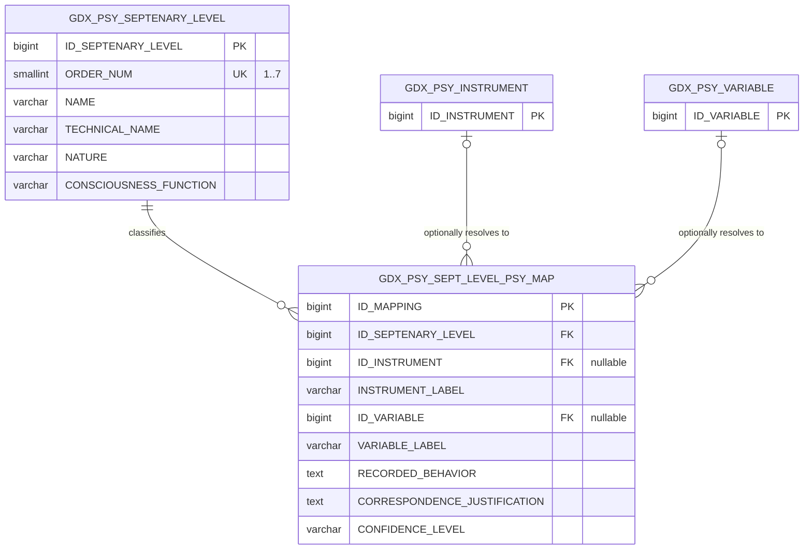
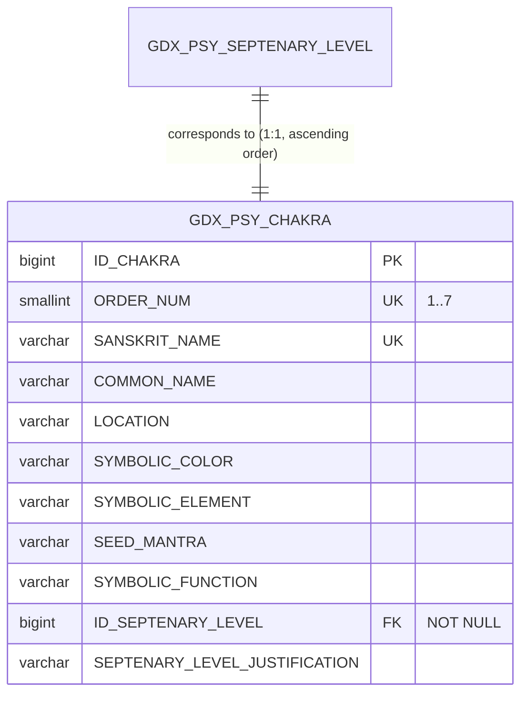
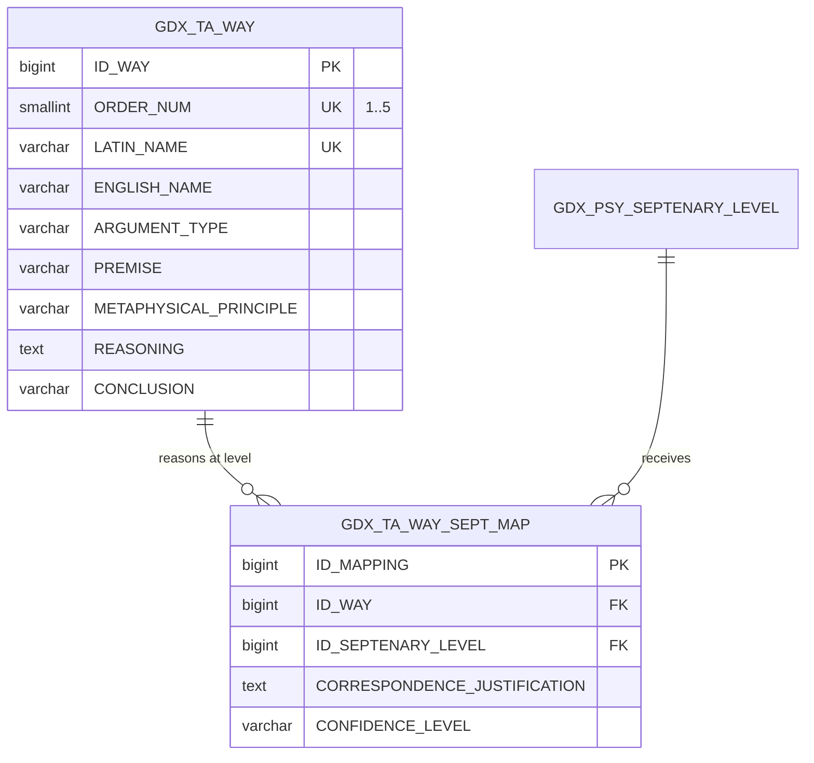
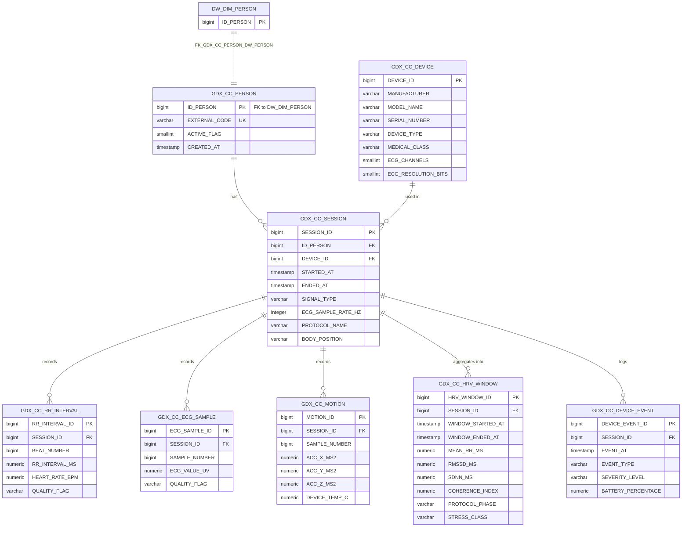
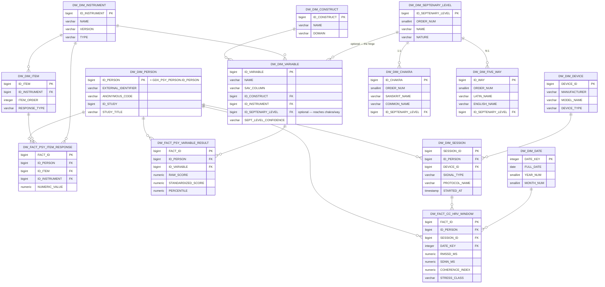
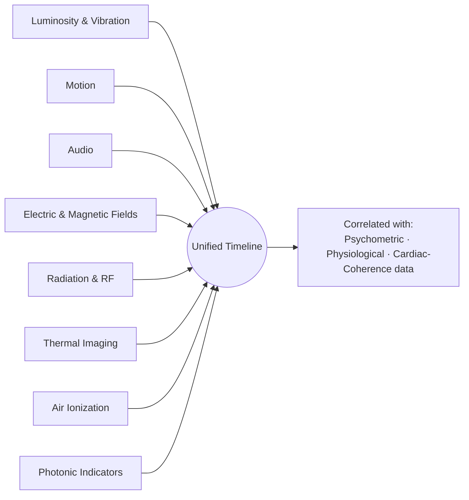
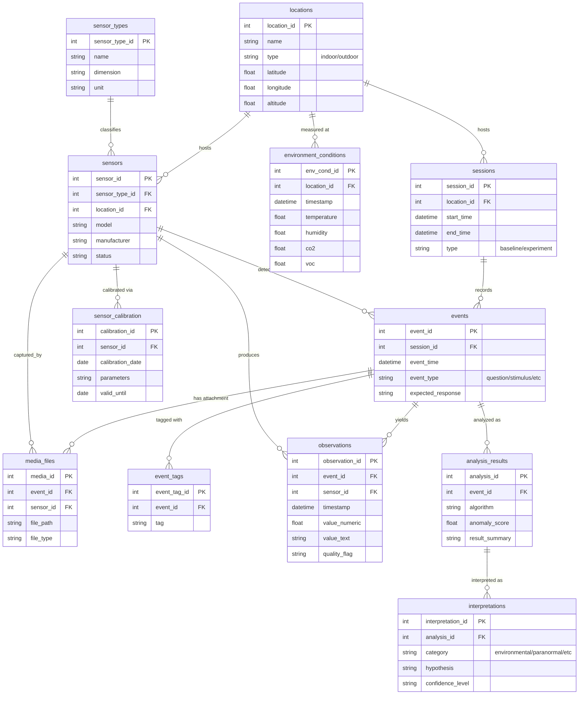
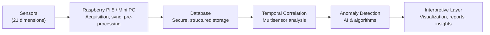
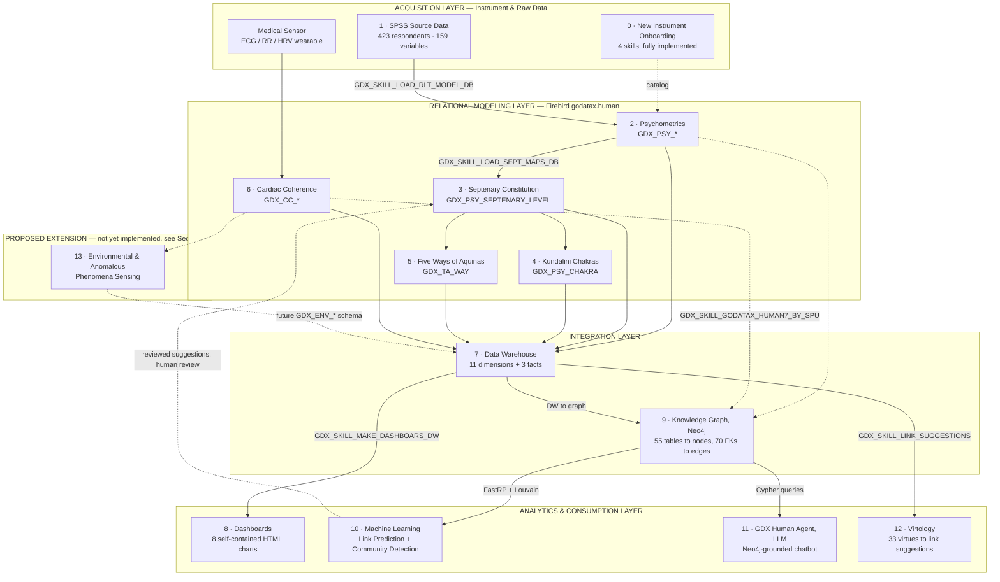

# GDX_HUMAN 7 — Developer Kit

> Generated 2026-09-22, from a direct read of every `.md` document, `SKILL.md` file, and
> `*.sql` DDL/DML script in this repository, plus slides 84–90 of
> `GDX_CTP_H7/GDX_DOCUMENTS/GDX_HUMAN/GoDataXHuman7-Br2.odp`. This is the single entry point
> for a developer joining the project: what it is, how the pieces fit together, how to run
> every automation, and what each relational schema looks like.

## Repository

```
https://github.com/wilsonfda/godatax.human7.git
```

Main branch: `master`. There is no CI pipeline and no build step — this is a documentation +
SQL + Node.js/Python automation repository, not a compiled application. Every numbered
top-level folder is close to self-contained (its own `.claude/skills/`, its own `.md` docs,
its own `.sql`), which is why the folders are numbered in dependency order rather than grouped
by language or layer.

---

## Table of Contents

1. [Project Overview](#1-project-overview)
2. [Getting Started](#2-getting-started)
3. [Repository Map](#3-repository-map)
4. [The Pipeline, Step by Step (0–12)](#4-the-pipeline-step-by-step-012)
5. [Skills Catalog — Full Reference](#5-skills-catalog--full-reference)
6. [Deep Dive — The Data Warehouse](#6-deep-dive--the-data-warehouse-step-7)
7. [Deep Dive — The Knowledge Graph](#7-deep-dive--the-knowledge-graph-step-9)
8. [Deep Dive — Machine Learning Models](#8-deep-dive--machine-learning-models-step-10)
9. [Deep Dive — The LLM Knowledge-Graph Agent](#9-deep-dive--the-llm-knowledge-graph-agent-step-11)
10. [Deep Dive — Virtology & Link Suggestions](#10-deep-dive--virtology--link-suggestions-step-12)
11. [Cross-Cutting Design Principles](#11-cross-cutting-design-principles)
12. [Proposed Architecture Extension — Environmental, Energetic & Anomalous Phenomena Sensing](#12-proposed-architecture-extension--environmental-energetic--anomalous-phenomena-sensing)
13. [Logical Architecture Diagram](#13-logical-architecture-diagram)
14. [Appendix — Where to Go Next](#14-appendix--where-to-go-next)

---

## 1. Project Overview

**GDX_HUMAN 7** (GoDataX Human) is a data-engineering and research project that starts from one
real psychometric study — *"Predictors of Adaptability to Military Higher Education,"* applied
to 423 cadets at the Military Academy — and expands it in several directions:

1. **A rigorous relational model** of the raw psychometric data (item-level responses,
   dimension scores, instruments, constructs) in a Firebird 2.5 database.
2. **Interpretive/qualitative bridges** between that scientific base and four distinct
   philosophical/esoteric traditions — the theosophical Septenary Constitution, the 7 Kundalini
   chakras, Thomas Aquinas's Five Ways, and *Virtology* (a 33-virtue neuro-philosophical
   system) — always kept explicit as **conceptual readings, not statistical findings**.
3. **Physiological data** (cardiac coherence / HRV device) linked to the same person
   identity as the psychometric study.
4. **An analytical layer** (a star-schema data warehouse) unifying all these perspectives for
   cross-cutting queries.
5. **A knowledge graph** (Neo4j) mirroring the entire relational schema, feeding two
   graph-machine-learning models (link prediction, community detection) and an LLM assistant.
6. **A repeatable pipeline** for onboarding **new** studies/instruments from scratch — the
   original 423-cadet study was loaded once, by hand; any future study goes through a generic
   skill assembly line (interview → SQL generation → load → questionnaire export → answer load).

Nearly all automation in the project is implemented as **Claude Code skills**
(`.claude/skills/` inside each folder), each with its own `SKILL.md`. The general pattern is
**"generate, then execute"**: a Python or Node.js script reads the data source and generates
SQL; a second script executes that SQL against Firebird (`--dry-run` always available before a
real write).

### The source data, in one sentence

An IBM SPSS `.sav` file with **no embedded metadata** (no variable labels, no value labels) —
every column's meaning (`AC1`, `Ha7`, `ENGAGvigor`, …) had to be reverse-engineered from
external support documents (`.pptx`/`.docx`, no longer present in the repo) and is documented in
`2.relational.model.psychometrics/SPSS_to_Firebird_Mapping.md` and
`1.output.ibm.spss.statistics/PLANILHAPOSDOC11SET_SO_CADETES_Documentacao.md`. **423
respondents, 159 columns** — 137 raw items across 9 instruments, 1 context variable (`ano`,
curricular year) and 20 pre-computed dimension scores.

### One person, one identity, everywhere

A design decision cuts across folders 2, 6, 7 and 9: **there is exactly one person identity in
the whole project**, `GDX_PSY_PERSON.ID_PERSON`. `DW_DIM_PERSON` is a faithful copy of it;
`GDX_CC_PERSON.ID_PERSON` is a direct FK into it (not a parallel catalog); the Neo4j graph
inherits the same id as `gdx_key`. Today only one person (`SPSS-784`) has both psychometric and
cardiac-coherence data — which limits what the dashboards/ML can show about the intersection of
the two sources, but the architecture is already built for more.

---

## 2. Getting Started

### 2.1 Technology stack

| Concern | Technology | Notes |
|---|---|---|
| Relational database | **Firebird 2.5** | All OLTP schemas (`GDX_PSY_*`, `GDX_TA_*`, `GDX_CC_*`) and the DW (`DW_DIM_*`/`DW_FACT_*`) live in one database, `godatax.human` |
| DB connectivity (Node.js) | [`node-firebird`](https://www.npmjs.com/package/node-firebird) | Pure wire-protocol driver — no native client library needed on the machine running a skill |
| Graph database | **Neo4j AuraDB** (with Graph Data Science / Aura Graph Analytics) | Free tier is sufficient for this project's graph size |
| Graph connectivity (Node.js) | [`neo4j-driver`](https://www.npmjs.com/package/neo4j-driver) | |
| Generation scripts | **Python** (`pyreadstat`, `pandas`, `numpy`, `semopy`, `scikit-learn`, `openpyxl`) and **Node.js** | Python for `.sav` reading and statistical analysis (CFA/EFA); Node.js for every database read/write |
| Dashboards | Self-contained **HTML/CSS/JS** files | No server, no external CDN — open directly in a browser |
| Automation framework | **Claude Code skills** (`.claude/skills/<NAME>/SKILL.md`) | Each skill folder has its own `scripts/`, `package.json`, and `.env.example` |

Every skill that touches Firebird or Neo4j is a small, independent Node.js (or Python) project:
`cd` into its `scripts/` folder, `npm install` once, copy `.env.example` to `.env`, run.

### 2.2 Credentials & environment variables

Every skill reads connection settings from environment variables — **never hardcoded** (this is
an explicit, repo-wide rule, called out in nearly every `SKILL.md` and `.env.example`). The two
conventions used throughout the repository:

```bash
# Firebird (godatax.human) — used by every skill that reads/writes GDX_PSY_*/GDX_TA_*/GDX_CC_*/DW_*
GDX_HUMAN_FB_HOST=127.0.0.1
GDX_HUMAN_FB_PORT=3050
GDX_HUMAN_FB_DATABASE=/firebird/godatax.gdb
GDX_HUMAN_FB_USER=godatax1
GDX_HUMAN_FB_PASSWORD=

# Neo4j (AuraDB) — used only by the knowledge-graph export and the two ML skills
NEO4J_URI=neo4j+s://xxxxxxxx.databases.neo4j.io
NEO4J_USERNAME=
NEO4J_PASSWORD=
NEO4J_DATABASE=
```

`.env` files are gitignored everywhere (`.gitignore` explicitly keeps `.env.example` while
excluding `.env`); only `.env.example` (no secrets) is committed.

### 2.3 Running a skill — the general pattern

Almost every database-writing skill follows the same shape:

```bash
cd <folder>/.claude/skills/<SKILL_NAME>/scripts
npm install                        # once
# copy ../.env.example to ../.env and fill in the password, or export the vars directly
node <script>.js --dry-run [--study <slug>]   # see what would happen, writes nothing
node <script>.js [--study <slug>]             # apply it — confirm with a human first
```

- `--dry-run` is supported by essentially every write-capable skill.
- `--study <slug>` scopes a run to one study (see §4.0 and §11) and is required by every skill
  built or updated since 2026-09-17/18 (dashboards, DW loader, knowledge-graph export, link
  suggestions).
- Read-only analysis skills (the two `10.gdx.machine.learning` ML skills) never touch Firebird —
  only Neo4j.

### 2.4 Sharing the skills with a team

These are **Claude Code skills**, not a claude.ai (web/desktop chat) feature. claude.ai's own
"Skills" run in an isolated cloud sandbox with no outbound network access to a private host and
no access to a local `.env` — a skill that needs to reach `127.0.0.1` or a Neo4j
AuraDB instance with real credentials **cannot** run there. Every skill in this repository is
designed to run **locally**, inside Claude Code, on a machine that has network access to the
database and its own `.env`. Two different audiences need two different kinds of access:

#### 2.4.1 Teammates who will run the skills themselves

1. **Repository access.** The repo is hosted at
   `https://github.com/wilsonfda/godatax.human7.git`. If it is private, add each teammate as a
   collaborator (or invite them to the GitHub org/team that owns it).
2. **Local setup**, per teammate: install Claude Code, `git clone` the repository, then for every
   skill they will actually use, `cd` into its `scripts/` folder and `npm install` once (§2.1).
3. **Skill discovery is not recursive.** Claude Code discovers project-level skills by searching
   `.claude/skills/` **upward** from the current working directory toward the repository root —
   it does **not** scan downward into every subdirectory. Because each numbered folder has its
   own `.claude/skills/` (§3), opening Claude Code at the repository root does **not**
   automatically surface the skills nested inside `0.new.instrument/`,
   `2.relational.model.psychometrics/`, `9.knowledge.graph/`, etc. In practice this is already
   how the repo is meant to be used (§2.3's own `cd <folder>/.claude/skills/<SKILL_NAME>/scripts`
   pattern), but it is worth being explicit about for anyone unfamiliar with Claude Code:
   - **Default, no extra setup:** `cd` into the specific numbered folder before invoking that
     folder's skill. This matches the pattern already used throughout §2.3 and §5.
   - **One Claude Code session across several folders:** run `/add-dir <folder>` (Claude Code
     v2.1.257+) for each numbered folder whose skills are needed in that session, instead of
     restarting Claude Code every time the working folder changes.
   - **Team-wide, install-once alternative:** package the skills as a **Claude Code plugin** and
     publish it to a **plugin marketplace** (a git repository can serve as one). A teammate then
     runs `/plugin marketplace add <repo>` once and `/plugin install <skill>@<marketplace>` per
     skill (or the marketplace's default set), and the skills become available in every project
     without depending on the working directory. Plugin skills and project-level `.claude/skills/`
     skills can coexist; a marketplace/plugin pairing can be declared in `.claude/settings.json`,
     e.g.:
     ```json
     {
       "extraKnownMarketplaces": {
         "gdx-human7-skills": {
           "source": { "source": "github", "repo": "wilsonfda/godatax.human7" }
         }
       },
       "enabledPlugins": { "gdx-human7@gdx-human7-skills": true }
     }
     ```
     This is the recommended path once more than a couple of people need the full skill set
     regularly — it removes the "which folder am I in" question entirely.
4. **Credentials, per teammate.** Every skill reads Firebird/Neo4j connection settings from
   `.env` (§2.2), never hardcoded. Prefer creating a **separate Firebird user and a separate
   Neo4j AuraDB user per teammate** (scoped to read-only where write access isn't needed) over
   sharing one password — this keeps `--dry-run`/write-guard mistakes attributable and makes
   revoking one person's access trivial.

#### 2.4.2 People who only need to see results, no install

Several outputs of this pipeline need **no** Claude Code, no `.env`, and no database access at
all, because they are pre-rendered, self-contained artifacts:

- **The 8 dashboards** (`8.gdx.dashboards/`, §5 of the Skills Catalog) are standalone
  `.html` files with inline SVG and no external dependency — open directly in a browser, or send
  the file. They are also published live on the GoDataX website
  (`gdx-source-development-kit.html`, embedded as iframes), so pointing a non-technical
  stakeholder at that page is usually the fastest option.
- **The written deep-dive docs** (`Dashboards_DW_Explanation.md`,
  `GoDataX_Human_7_Knowledge_Graph.md`, `Septenary_Link_Prediction_and_Community_Detection.md`,
  this file, and others) are plain Markdown — readable on GitHub or any Markdown viewer.

#### 2.4.3 Conversational access without Claude Code (advanced)

To let someone ask natural-language questions grounded in the Neo4j graph (§9, the
`11.gdx.llm.agent.mcp/prompt.instruction.txt` system prompt) **without** installing Claude Code,
claude.ai's sandboxed Skills feature is the wrong tool (see the warning above), but claude.ai's
**Connectors** (remote MCP servers, available on Team/Enterprise plans) are not sandboxed the
same way — a Connector is explicitly meant to reach a service you host. The path is:

1. Stand up an MCP server that exposes the Neo4j graph (a small wrapper around `neo4j-driver`,
   hosted anywhere reachable over HTTPS — this does not exist in the repo yet and would need to
   be built).
2. Register its URL as a custom Connector in the claude.ai Team/Enterprise admin settings, and
   load `prompt.instruction.txt` as that Connector-enabled chat's system prompt/Project
   instructions.
3. Teammates with access to that Connector can then query the graph conversationally from
   ordinary claude.ai chat, with the same rigor rules the prompt enforces (§9): always
   distinguish empirical data from interpretation, never diagnose, always show the graph path.

This is meaningfully more infrastructure work than §2.4.1–2.4.2 (a server to host and secure) and
is not required for the pipeline to function — it only matters if conversational, install-free
access to the graph is a real requirement.

---

## 3. Repository Map

```
GDX_HUMAN7/
  0.new.instrument/               <- generic pipeline to onboard a NEW study from scratch
  1.output.ibm.spss.statistics/   <- the original .sav file + its full data documentation
  2.relational.model.psychometrics/  <- the GDX_PSY_* schema (core of everything) + the loaded study
  3.septenary.constitution/       <- interpretive bridge: instruments × 7 theosophical bodies/levels
  4.kundalini.chakras/            <- interpretive bridge: 7 chakras × septenary levels
  5.five.ways.tomas.aquino/       <- interpretive bridge: Aquinas's 5 ways × septenary levels
  6.cardiac.coherence/            <- physiological data (ECG/HRV device), same person identity
  7.multidimensional.database/    <- the Data Warehouse (star schema) unifying folders 2–6
  8.gdx.dashboards/               <- 8 self-contained HTML dashboards reading the DW
  9.knowledge.graph/              <- export of the whole relational schema into Neo4j
  10.gdx.machine.learning/        <- 2 graph ML models (link prediction, community detection)
  11.gdx.llm.agent.mcp/           <- system prompt for an LLM assistant over the knowledge graph
  12.gdx.virtology/                <- knowledge base of 33 virtues + link-suggestion skill
```

The numbering reflects, broadly, dependency order: every folder consumes data from lower-numbered
folders (the DW in folder 7 reads folders 2–6; the dashboards in folder 8 read folder 7; the
graph in folder 9 reads folders 2–7; the ML in folder 10 reads folder 9 only).

---

## 4. The Pipeline, Step by Step (0–12)

### Step 0 — `0.new.instrument/` — Onboarding a brand-new study

Four chained skills, documented in full in `New_Instrument_Onboarding_Process.md`:

```
GDX_SKILL_NEW_STUDY            conversational interview -> new_study_intake/<slug>/intake.json
        |
GDX_SKILL_RECORD_NEW_STUDY     generates SQL from intake.json + executes it against Firebird
        |
GDX_SKILL_EXPORT_NEW_STUDY     reads Firebird -> generates a blank .xlsx questionnaire
        |
   (send one copy per participant, wait for it to come back filled in)
        |
GDX_SKILL_LOAD_NEW_STUDY_ANSWERS   reads ONE filled .xlsx -> writes responses into Firebird
```

Unlike the historical study (loaded once, by hand, via `GDX_SKILL_LOAD_RLT_MODEL_DB`), this
assembly line is **generic**: it never hardcodes an id (it relies on Firebird `BEFORE INSERT`
triggers), never invents a field the user doesn't know the answer to, and never duplicates an
already-onboarded study. **Filled** `.xlsx` files (real participant data) must never be
committed — only `intake.json` and the generated SQL are meant to be committed.

See §5 for the full per-skill reference.

### Step 1 — `1.output.ibm.spss.statistics/` — The source data

The historical study's `.sav` file (423 cadets) and its complete documentation. No skill lives
here — it is a raw data source, read by `GDX_SKILL_LOAD_RLT_MODEL_DB` (folder 2).

**Instruments identified with high confidence** (from `PLANILHAPOSDOC11SET_SO_CADETES_Documentacao.md`):

| Instrument | Raw columns | Computed dimensions |
|---|---|---|
| Hardiness | `Ha1`–`Ha30` (30) | Commitment, Control, Challenge |
| Student Engagement Scale | `En1`–`En14` (14) | Vigor, Dedication, Absorption |
| Career Adapt-Abilities Scale (CAAS) | `AC1`–`AC28` (28) | Concern, Control, Curiosity, Confidence |
| Satisfaction With Life Scale (SWLS) | `SV1`–`SV5` (5) | Single index |
| Job Satisfaction Scale | `ST1`–`ST5` (5) | Single index |
| Positivity Ratio Scale | `RP1`–`RP20` (20) | Positive / Negative Emotions |
| Personal Satisfaction | 1 item | Single index |
| Perceived Control of Life | 1 item | Single index |

Three additional blocks (`ef1`–`ef18`, `an1`–`an11`, `red1`–`red5`) are **medium/low-confidence
hypotheses** (Maslach Burnout Inventory, an unidentified "organizational anomie" block, and
"Red Tape") — no supporting document confirms their authorship or exact item wording. This gap
is documented, not guessed at.

### Step 2 — `2.relational.model.psychometrics/` — The core: `GDX_PSY_*` schema

The heart of the project: `psychometrics_model_firebird25.sql` defines the full relational model
(study → instrument → construct → variable/indicator → item → response alternative →
application → response → computed result). See §4.2's ER diagram below.

**Skills:** `GDX_SKILL_LOAD_RLT_MODEL_DB` (loads the historical `.sav` study),
`GDX_SKILL_MAKE_ANALYSES_CFA_EFA` (re-runs the CAAS factor analyses from the database instead of
the `.sav`, as a cross-check).

**Key docs:** `SPSS_to_Firebird_Mapping.md` (the full reasoning behind the mapping),
`RLT_Model_Load_and_CFA_EFA_Analyses.md`.

#### ER Diagram — `GDX_PSY_*`

```mermaid
erDiagram
    GDX_PSY_PERSON ||--o{ GDX_PSY_TEAM : "leads"
    GDX_PSY_TEAM ||--o{ GDX_PSY_TEAM_MEMBER : has
    GDX_PSY_PERSON ||--o{ GDX_PSY_TEAM_MEMBER : "is member"
    GDX_PSY_PERSON ||--o{ GDX_PSY_PERSON_OCCUPATION : has
    GDX_PSY_OCCUPATION ||--o{ GDX_PSY_PERSON_OCCUPATION : classifies
    GDX_PSY_STUDY ||--o{ GDX_PSY_STUDY_PARTICIPANT : enrolls
    GDX_PSY_PERSON ||--o{ GDX_PSY_STUDY_PARTICIPANT : participates
    GDX_PSY_PHENOMENON ||--o{ GDX_PSY_PHENOMENON_CONSTRUCT : "explained by"
    GDX_PSY_CONSTRUCT ||--o{ GDX_PSY_PHENOMENON_CONSTRUCT : explains
    GDX_PSY_CONSTRUCT ||--o{ GDX_PSY_CONSTRUCT : "parent of"
    GDX_PSY_CONSTRUCT ||--o{ GDX_PSY_VARIABLE : decomposes
    GDX_PSY_VARIABLE ||--o{ GDX_PSY_INDICATOR : decomposes
    GDX_PSY_INSTRUMENT ||--o{ GDX_PSY_INSTRUMENT_CONSTRUCT : measures
    GDX_PSY_CONSTRUCT ||--o{ GDX_PSY_INSTRUMENT_CONSTRUCT : "measured by"
    GDX_PSY_INSTRUMENT ||--o{ GDX_PSY_INSTRUMENT_ITEM : contains
    GDX_PSY_INDICATOR ||--o{ GDX_PSY_INDICATOR_ITEM : "computed from"
    GDX_PSY_INSTRUMENT_ITEM ||--o{ GDX_PSY_INDICATOR_ITEM : feeds
    GDX_PSY_INSTRUMENT_ITEM ||--o{ GDX_PSY_ITEM_ALTERNATIVE : offers
    GDX_PSY_PERSON ||--o| GDX_PSY_EVALUATOR : "is"
    GDX_PSY_STUDY_PARTICIPANT ||--o{ GDX_PSY_APPLICATION : undergoes
    GDX_PSY_INSTRUMENT ||--o{ GDX_PSY_APPLICATION : "applied in"
    GDX_PSY_EVALUATOR ||--o{ GDX_PSY_APPLICATION : conducts
    GDX_PSY_APPLICATION ||--o{ GDX_PSY_ITEM_RESPONSE : records
    GDX_PSY_INSTRUMENT_ITEM ||--o{ GDX_PSY_ITEM_RESPONSE : "answered via"
    GDX_PSY_ITEM_ALTERNATIVE ||--o{ GDX_PSY_ITEM_RESPONSE : chosen
    GDX_PSY_APPLICATION ||--o{ GDX_PSY_CONSTRUCT_RESULT : yields
    GDX_PSY_CONSTRUCT ||--o{ GDX_PSY_CONSTRUCT_RESULT : scored
    GDX_PSY_APPLICATION ||--o{ GDX_PSY_VARIABLE_RESULT : yields
    GDX_PSY_VARIABLE ||--o{ GDX_PSY_VARIABLE_RESULT : scored
    GDX_PSY_APPLICATION ||--o{ GDX_PSY_INDICATOR_RESULT : yields
    GDX_PSY_INDICATOR ||--o{ GDX_PSY_INDICATOR_RESULT : scored
    GDX_PSY_INSTRUMENT ||--o{ GDX_PSY_PSYCHOMETRIC_PROPERTY : "has property"
    GDX_PSY_CONSTRUCT ||--o{ GDX_PSY_PSYCHOMETRIC_PROPERTY : "has property"
    GDX_PSY_STUDY_PARTICIPANT ||--o{ GDX_PSY_OBSERVATION : "observed in"
    GDX_PSY_EVALUATOR ||--o{ GDX_PSY_OBSERVATION : records
    GDX_PSY_CONSTRUCT ||--o{ GDX_PSY_OBSERVATION : "about"
    GDX_PSY_STUDY_PARTICIPANT ||--o{ GDX_PSY_EVALUATION : "evaluated in"
    GDX_PSY_EVALUATOR ||--o{ GDX_PSY_EVALUATION : conducts
    GDX_PSY_EVALUATION ||--o{ GDX_PSY_EVALUATION_ACTION : recommends
    GDX_PSY_ACTION ||--o{ GDX_PSY_EVALUATION_ACTION : "recommended as"

    GDX_PSY_PERSON {
        bigint ID_PERSON PK
        varchar NAME
        varchar EXTERNAL_IDENTIFIER UK
        date BIRTH_DATE
        varchar GENDER
    }
    GDX_PSY_TEAM {
        bigint ID_TEAM PK
        varchar NAME
        bigint ID_LEADER FK
    }
    GDX_PSY_STUDY {
        bigint ID_STUDY PK
        varchar TITLE
        varchar STATUS
    }
    GDX_PSY_STUDY_PARTICIPANT {
        bigint ID_STUDY PK, FK
        bigint ID_PERSON PK, FK
        varchar ANONYMOUS_CODE UK
        smallint CONSENT
    }
    GDX_PSY_PHENOMENON {
        bigint ID_PHENOMENON PK
        varchar NAME
    }
    GDX_PSY_CONSTRUCT {
        bigint ID_CONSTRUCT PK
        bigint ID_PARENT_CONSTRUCT FK
        varchar NAME UK
        varchar DOMAIN
    }
    GDX_PSY_VARIABLE {
        bigint ID_VARIABLE PK
        bigint ID_CONSTRUCT FK
        varchar NAME
        varchar VARIABLE_TYPE
    }
    GDX_PSY_INDICATOR {
        bigint ID_INDICATOR PK
        bigint ID_VARIABLE FK
        varchar NAME
        numeric MIN_VALUE
        numeric MAX_VALUE
    }
    GDX_PSY_INSTRUMENT {
        bigint ID_INSTRUMENT PK
        varchar NAME
        varchar VERSION
        varchar TYPE
        smallint ACTIVE
    }
    GDX_PSY_INSTRUMENT_ITEM {
        bigint ID_ITEM PK
        bigint ID_INSTRUMENT FK
        integer ITEM_ORDER
        text STATEMENT_TEXT
        varchar RESPONSE_TYPE
    }
    GDX_PSY_ITEM_ALTERNATIVE {
        bigint ID_ALTERNATIVE PK
        bigint ID_ITEM FK
        integer ALTERNATIVE_ORDER
        varchar LABEL
        numeric NUMERIC_VALUE
    }
    GDX_PSY_EVALUATOR {
        bigint ID_EVALUATOR PK
        bigint ID_PERSON FK
        varchar PROFESSIONAL_LICENSE
    }
    GDX_PSY_APPLICATION {
        bigint ID_APPLICATION PK
        bigint ID_STUDY FK
        bigint ID_PERSON FK
        bigint ID_INSTRUMENT FK
        bigint ID_EVALUATOR FK
        varchar STATUS
    }
    GDX_PSY_ITEM_RESPONSE {
        bigint ID_RESPONSE PK
        bigint ID_APPLICATION FK
        bigint ID_ITEM FK
        bigint ID_ALTERNATIVE FK
        numeric NUMERIC_VALUE
        text TEXT_VALUE
    }
    GDX_PSY_CONSTRUCT_RESULT {
        bigint ID_RESULT PK
        bigint ID_APPLICATION FK
        bigint ID_CONSTRUCT FK
        numeric RAW_SCORE
        numeric PERCENTILE
    }
    GDX_PSY_VARIABLE_RESULT {
        bigint ID_VARIABLE_RESULT PK
        bigint ID_APPLICATION FK
        bigint ID_VARIABLE FK
        numeric RAW_SCORE
        numeric PERCENTILE
    }
    GDX_PSY_INDICATOR_RESULT {
        bigint ID_INDICATOR_RESULT PK
        bigint ID_APPLICATION FK
        bigint ID_INDICATOR FK
        numeric CALCULATED_VALUE
    }
    GDX_PSY_PSYCHOMETRIC_PROPERTY {
        bigint ID_PROPERTY PK
        bigint ID_INSTRUMENT FK
        bigint ID_CONSTRUCT FK
        varchar TYPE
        varchar METHOD
        numeric VALUE
        integer SAMPLE_SIZE
    }
    GDX_PSY_OBSERVATION {
        bigint ID_OBSERVATION PK
        bigint ID_STUDY FK
        bigint ID_PERSON FK
        bigint ID_EVALUATOR FK
        bigint ID_CONSTRUCT FK
        text BEHAVIOR
    }
    GDX_PSY_EVALUATION {
        bigint ID_EVALUATION PK
        bigint ID_STUDY FK
        bigint ID_PERSON FK
        bigint ID_EVALUATOR FK
        varchar TYPE
        varchar CONCLUSION
    }
    GDX_PSY_ACTION {
        bigint ID_ACTION PK
        varchar NAME
        varchar TYPE
    }
    GDX_PSY_EVALUATION_ACTION {
        bigint ID_EVALUATION PK, FK
        bigint ID_ACTION PK, FK
        smallint PRIORITY
        varchar STATUS
    }
```



28 tables in total (`GDX_PSY_OCCUPATION`/`PERSON_OCCUPATION` omitted from the diagram above for
space — a simple person↔occupation history table). Every surrogate key is a `BIGINT` populated by
a Firebird `BEFORE INSERT` trigger reading from a matching `SEQ_GDX_PSY_*` sequence — no id is
ever hardcoded by application code except in the frozen, one-time historical load scripts.

**Key rules baked into the DDL:**
- `GDX_PSY_PERSON.EXTERNAL_IDENTIFIER` and `GDX_PSY_STUDY_PARTICIPANT(ID_STUDY, ANONYMOUS_CODE)`
  are unique — one physical person, one row, reusable across studies.
- `GDX_PSY_ITEM_RESPONSE` is unique per `(ID_APPLICATION, ID_ITEM)`; every `*_RESULT` table is
  unique per `(ID_APPLICATION, ID_CONSTRUCT|ID_VARIABLE|ID_INDICATOR)` — one answer, one computed
  score, per application.
- `PERCENTILE` columns are check-constrained to `[0, 100]`; boolean-like flags (`CONSENT`,
  `ACTIVE`, `REVERSED`) are check-constrained to `(0,1)`.
- `GDX_PSY_APPLICATION`/`OBSERVATION`/`EVALUATION` all FK to the **composite** key
  `(ID_STUDY, ID_PERSON)` of `GDX_PSY_STUDY_PARTICIPANT`, not to `GDX_PSY_PERSON` directly — a
  person must be enrolled in the study before anything can reference them there.

### Step 3 — `3.septenary.constitution/` — Interpretive bridge: instruments × 7 bodies

**Skill:** `GDX_SKILL_LOAD_SEPT_MAPS_DB`. **Doc:** `SPSS_Septenary_Constitution_Mapping.md`.

Catalogs the 7 levels of the theosophical Septenary Constitution (Physical → Vital/Etheric →
Astral → Lower Mental → Higher Mental → Buddhic → Atmic/Spirit) and relates psychometric
variables to them, each row carrying a written justification and a `CONFIDENCE_LEVEL`
(`HIGH`/`MEDIUM`/`LOW`/`SPECULATIVE`).



`ID_INSTRUMENT`/`ID_VARIABLE` are nullable by design: this mapping was populated by free-text
label (`INSTRUMENT_LABEL`/`VARIABLE_LABEL`) before the formal `GDX_PSY_INSTRUMENT`/
`GDX_PSY_VARIABLE` catalog existed, and is reconciled to real ids afterward (by
`GDX_SKILL_LOAD_SEPT_MAPS_DB` or the DW ETL). `ORDER_NUM` is check-constrained to `1..7` and
unique — exactly 7 levels, ordered; `CONFIDENCE_LEVEL` is check-constrained to
`HIGH/MEDIUM/LOW/SPECULATIVE`. No uniqueness constraint exists on `(ID_SEPTENARY_LEVEL,
ID_VARIABLE)` — a level can (and does) receive multiple variable mappings.

### Step 4 — `4.kundalini.chakras/` — Interpretive bridge: 7 chakras

No skill (static DDL/DML) — `chakras_model_firebird25.sql` creates one catalog table, a strict
**1:1 ascending correspondence** to `GDX_PSY_SEPTENARY_LEVEL` (chakra of order *N* ↔ septenary
level of order *N*, a common yoga-theosophy syncretism, explicitly framed as symbolic, not
empirical).



Unlike the septenary mapping table (§4.3), `ID_SEPTENARY_LEVEL` here is `NOT NULL` — every chakra
always resolves to exactly one level, and the correspondence is fixed DDL/DML (no loader skill
ever touches this table).

### Step 5 — `5.five.ways.tomas.aquino/` — Interpretive bridge: the Five Ways

No skill (static DDL/DML). `five_ways_model_firebird25.sql` catalogs Thomas Aquinas's five
cosmological/teleological arguments for God's existence (*Summa Theologica* I, Q.2, Art.3).
`five_ways_septenary_map_firebird25.sql` relates each way to the septenary level that best
matches the *faculty of reasoning* it exercises — deliberately **N:1** (levels 4/4/5/5/6), never
trivially mapping all five to level 7 (their shared conclusion).



`GDX_TA_WAY_SEPT_MAP` is unique on `(ID_WAY, ID_SEPTENARY_LEVEL)`. Confidence is mixed by design:
way 4 → Higher Mental is rated `HIGH` (an explicit textual match to "values/judgment"), way 5 →
Buddhic is `SPECULATIVE`, the rest `MEDIUM` — the table does not claim uniform certainty across
all five ways.

### Step 6 — `6.cardiac.coherence/` — Physiological data (ECG/HRV)

No dedicated onboarding skill for the schema itself (static DDL/DML + a simulation dataset), but
`GDX_SKILL_LOAD_CC_MAPS_DB` links its participants to a study. Schema `GDX_CC_*` for capturing
cardiac coherence with the medical ECG/HRV device.

**Key doc:** `GDX_CC_Psychometrics_Person_Mapping.md` — central point: **`GDX_CC_PERSON` is not
a parallel person catalog**; its `ID_PERSON` is a direct FK into `DW_DIM_PERSON`/
`GDX_PSY_PERSON`, the same identity used on the psychometric side (enforced at the database
level since step 7's cross-schema FK was added). What is still missing per new participant is
their **study** association (`GDX_PSY_STUDY_PARTICIPANT`), which is exactly
`GDX_SKILL_LOAD_CC_MAPS_DB`'s job.



Device specs baked into check constraints: `ECG_SAMPLE_RATE_HZ IN
(125,128,200,250,256,500,512)`, 15-bit resolution, `HEART_RATE_BPM BETWEEN 20 AND 240`,
`RR_INTERVAL_MS BETWEEN 250 AND 3000`. Every child table (`RR_INTERVAL`/`ECG_SAMPLE`/`MOTION`/
`HRV_WINDOW`/`DEVICE_EVENT`) cascades on `SESSION_ID` delete. `STRESS_CLASS` and `DEVICE_TEMP_C`
carry explicit column comments warning they are **not** a diagnosis / not body temperature —
algorithmic classification and internal-device temperature only.

### Step 7 — `7.multidimensional.database/` — The Data Warehouse

See the full deep dive in **§6**. Star schema (11 dimensions + 3 facts) unifying the 5 OLTP
perspectives (steps 2–6) into one queryable point. Skills: none for the initial one-shot ETL
(plain SQL); `GDX_SKILL_LOAD_NEW_STUDY_DW` for incremental, per-study loading.

### Step 8 — `8.gdx.dashboards/` — 8 self-contained HTML charts

**Skill:** `GDX_SKILL_MAKE_DASHBOARS_DW`. Reads the DW (step 7), scoped by `--study <slug>`,
and writes 8 standalone `.html` files (no server, no external CDN): a line chart (physiological
response), a bar chart (score by septenary level), 4 heatmaps (instrument × level / cardiac
stress / chakra / Five Ways), and 2 "gradient portrait" figures (chakra silhouette, septenary
constitution diagram). See §5 for the full flag/output reference and `Dashboards_DW_Explanation.md`
for a chart-by-chart reading of the real numbers.

### Step 9 — `9.knowledge.graph/` — Export to Neo4j

See the full deep dive in **§7**. `GDX_SKILL_GODATAX_HUMAN7_BY_SPU` turns the entire in-scope
Firebird schema (55 tables, 70 FKs) into a Neo4j property graph — one node label per table, one
relationship type per FK — discovered live via `RDB$` catalog introspection, not a hand-written
mapping. Scoped by `--study <slug>` since 2026-09-18.

### Step 10 — `10.gdx.machine.learning/` — Two graph ML models

See the full deep dive in **§8**. Both implemented as skills, both read **only** Neo4j:

- **Model 1 — Link Prediction** (`GDX_SKILL_GODATAX_HUMAN7_LINK_PRED`): FastRP embeddings +
  a classifier trained on the 18–19 existing variable→level mappings, suggests the top-3
  candidate levels for every unmapped variable. **Triage aid only — never auto-writes.**
- **Model 2 — Community Detection** (`GDX_SKILL_GODATAX_HUMAN7_COMMUNITY_DETECT`): unsupervised
  Louvain (cross-checked with Label Propagation), compares structural clusters against the
  existing septenary/chakra labels.

### Step 11 — `11.gdx.llm.agent.mcp/` — LLM assistant over the graph

A single file, `prompt.instruction.txt`: the system prompt for an LLM assistant connected to the
Neo4j graph, with explicit rigor rules (never invent data, always distinguish empirical data /
computed indicator / psychological interpretation / philosophical-metaphysical interpretation /
traditional energetic model, never present a metaphysical correspondence as a scientifically
validated causal relationship, never diagnose). See §9.

### Step 12 — `12.gdx.virtology/` — The 33 virtues & link suggestions

`Virtology_Knowledge_Base.md` captures (via an automated, explicitly-flagged-as-unverified fetch)
Eduardo Casarotto's "Virtology" system — 33 ordered virtues, Humility declared as the
foundation, plus two hypothesized primitive neural systems (SNO/SNE) the virtues are claimed to
neutralize. `GDX_SKILL_LINK_SUGGESTIONS` uses this base, together with an author-written
**variable→virtue** map (narrower than, and distinct from, the still-open virtue→neural-system
question), to rank a study's lowest-scoring psychometric indicators and suggest which virtue
addresses each — never inventing a suggestion for a variable with no map entry (reported as
*"no suggestion (review)"*). See §10.

---

## 5. Skills Catalog — Full Reference

14 skills exist today, grouped by the folder that owns them.

### `0.new.instrument/`

#### `GDX_SKILL_NEW_STUDY`
**Purpose:** Interviews a human to register a brand-new study, instrument(s), constructs,
variables/indicators, items, response anchors and scoring weights, grounding every question in
the live `GDX_PSY_*` schema and catalog.
**Trigger:** the user wants to register a new study/questionnaire/scale before any data exists
for it.
**Inputs:** a live read-only connection to Firebird (`scripts/check_catalog.js`), a conversation
with the user.
**Outputs:** `new_study_intake/<slug>/intake.json`, validated by `scripts/validate_intake.py`.
**How it works:**
1. Runs `check_catalog.js` (read-only `SELECT`s) so the interview can say "there is already a
   phenomenon called *Hardiness* — is this the same thing?" instead of risking a near-duplicate.
2. Walks the same FK chain as the DDL, parent before child: study → instrument → phenomenon →
   construct(s) → variable(s)/indicator(s) → response anchor sets → items (statement, anchor
   set, dimension, weight, reverse-scoring).
3. Writes `intake.json` and validates it structurally (`VARCHAR` length limits copied from the
   DDL) and cross-referentially (every reference resolves, no duplicate orders).
**Key rules:** never guesses an unanswered field (records it as `null`, flags it back); reuses
an existing phenomenon/construct by name instead of creating a near-duplicate.

#### `GDX_SKILL_RECORD_NEW_STUDY`
**Purpose:** Reads a validated `intake.json` and both generates and (optionally) executes the
Firebird load scripts that persist it.
**Trigger:** right after `GDX_SKILL_NEW_STUDY` has written a validated intake file.
**Inputs:** `new_study_intake/<slug>/intake.json`.
**Outputs:** `01_new_study.sql`, `02_new_instrument_NN_*.sql` (each a single Firebird `EXECUTE
BLOCK`), written next to `intake.json`; then `GDX_PSY_STUDY`/`PHENOMENON`/`CONSTRUCT`/
`VARIABLE`/`INDICATOR`/`INSTRUMENT`/`INSTRUMENT_ITEM`/`ITEM_ALTERNATIVE`/`INDICATOR_ITEM` rows.
**How it works:**
1. `generate_new_study_scripts.py` re-validates `intake.json`, then emits SQL that never
   hardcodes an id — every insert leaves the id column `NULL` and lets the schema's `BEFORE
   INSERT` triggers assign it from the matching sequence.
2. Each `02_new_instrument_*.sql` is one `EXECUTE BLOCK` capturing each new id via `RETURNING ...
   INTO :V_ID_X` so a child row (e.g. an item) can reference the id its parent row just got in
   the same transaction.
3. `execute_new_study.js --dir <intake-dir> --dry-run`, then for real.
**Key rules:** `01_new_study.sql` looks the study up by `TITLE` first, inserts only if missing
(so re-registering a second instrument for an already-onboarded study never duplicates the
study row); `GDX_PSY_INSTRUMENT` itself always inserts fresh — a genuine name+version duplicate
is left to fail loudly on the schema's own `UNIQUE` constraint, not silently skipped.

#### `GDX_SKILL_EXPORT_NEW_STUDY`
**Purpose:** Reads a newly-onboarded study's instruments/items/alternatives back out of Firebird
and writes a blank `.xlsx` questionnaire to send to participants.
**Trigger:** right after `GDX_SKILL_RECORD_NEW_STUDY` has loaded the study.
**Inputs:** `--study <slug>` (resolved via `intake.json`).
**Outputs:** `GDX_SKILL_EXPORT_NEW_STUDY_<StudyTitle>__<slug>.xlsx` next to `intake.json` — a
**Participant** sheet, one sheet per instrument (item text, response type, a blank **Answer**
column with an Excel dropdown when alternatives exist), and a hidden **META** sheet recording
every resolved id (`ID_STUDY`, `ID_INSTRUMENT`, `ID_ITEM`, `ID_ALTERNATIVE`, …).
**Key rules:** read-only against Firebird (writes only the `.xlsx`); the META sheet is what lets
a renamed/reopened/resaved copy still load correctly downstream — never re-resolves names.

#### `GDX_SKILL_LOAD_NEW_STUDY_ANSWERS`
**Purpose:** Reads one filled `.xlsx` (from the skill above) and inserts the participant's real
answers into Firebird.
**Trigger:** after a participant returns a filled workbook.
**Inputs:** `--file <path-to-filled.xlsx>`.
**Outputs:** `GDX_PSY_PERSON` (found-or-inserted by `EXTERNAL_IDENTIFIER`), `GDX_PSY_STUDY_PARTICIPANT`
(found-or-inserted), one `GDX_PSY_APPLICATION` per answered instrument sheet, one
`GDX_PSY_ITEM_RESPONSE` per answered item.
**Key rules:** trusts the workbook's own META sheet for every id, never re-resolves by name (a
filename mismatch is logged as a harmless note, never an error); an answer matching no
alternative label is reported under "UNMATCHED", never coerced to the nearest option; a required
item left blank is reported under "MISSING", never silently completed; every inserted
`GDX_PSY_APPLICATION` is tagged in `CONTEXT` with the source filename so **re-running on the
same file is safe** (it skips the instrument instead of duplicating responses); deliberately
does **not** compute `GDX_PSY_VARIABLE_RESULT`/`CONSTRUCT_RESULT`/`INDICATOR_RESULT` — scoring
raw responses is future work.

### `2.relational.model.psychometrics/`

#### `GDX_SKILL_LOAD_RLT_MODEL_DB`
**Purpose:** Regenerates and (optionally) runs the load scripts for the one historical `.sav`
study.
**Trigger:** the user wants to regenerate the psychometrics load scripts or refresh/sync the
`GDX_PSY_*` load from the `.sav`.
**Inputs:** `1.output.ibm.spss.statistics/PLANILHAPOSDOC11SET SO CADETES.sav`, the fixed catalog
`scripts/catalog.py` (instrument/dimension/item metadata hand-extracted from support documents —
this cannot be derived from the `.sav` itself, which carries no labels).
**Outputs:** `01_load_study.sql` … `08_adjust_sequences.sql` in
`2.relational.model.psychometrics/`, then the corresponding `GDX_PSY_*` rows in Firebird.
**How it works:**
1. `generate_load_scripts.py` re-reads the `.sav` fresh every run and cross-checks its actual
   columns against `catalog.py`, **printing a warning instead of guessing** on any mismatch.
2. `execute_load.js --dry-run` then for real — batches commits every 2000 statements on the two
   bulk files (~58k and ~8.9k statements).
**Key rules:** refuses to run if any `GDX_PSY_*` table is missing (does not apply DDL itself);
refuses to re-run if `GDX_PSY_STUDY.ID_STUDY = 1` already exists (idempotency guard, `--force`
skips it but nothing is ever deleted); `--only <1-8>` re-runs a single failed step.

#### `GDX_SKILL_MAKE_ANALYSES_CFA_EFA`
**Purpose:** Runs CFA/EFA psychometric analyses sourced from the live database instead of the
`.sav`, for all 11 instruments. Track A: re-runs the Career Adapt-Abilities Scale's CFA/EFA as an
independent cross-check. Track B: runs both EFA and CFA for every other multi-item instrument,
discovering item structure computationally since `GDX_PSY_INDICATOR_ITEM` is empty in this
database. Track C: descriptive statistics only for the two single-item instruments (no factor
analysis is mathematically possible with 1 item).
**Trigger:** the user wants to (re)verify the `.sav`-sourced CAAS psychometric properties, or run
factor analysis for instruments beyond CAAS ("all variables"/"all instruments").
**Inputs:** Track A: `GDX_PSY_ITEM_RESPONSE`/`GDX_PSY_VARIABLE_RESULT` for `ID_INSTRUMENT=3`. Track
B: same tables for `--instrument` in `{1,2,4,5,6,9,10,11}`. Track C: same tables for `{7,8}`.
**Outputs:** Track A: `output/09-11_..._from_db.sql`. Track B: `output/efa_instrument_<ID>_*.sql` +
`output/cfa_instrument_<ID>_*.sql`. Track C: `output/describe_instrument_<ID>_*.sql`. (Same
`GDX_PSY_PSYCHOMETRIC_PROPERTY` insert shape across all tracks; `data/instrument_<ID>_structure.json`
documents what Track B discovered per variable, confirmed or not.)
**How it works:**
1. Track A: `fetch_career_adaptability_items.js` pivots `AC1..AC28` into a CSV (plus the 4
   pre-computed dimension scores) -> `run_cfa_from_db.py` (semopy, 4-factor correlated CFA, ML) ->
   `run_efa_from_db.py` (`sklearn.decomposition.FactorAnalysis` + hand-rolled Varimax — the
   `factor_analyzer` package is broken against modern scikit-learn). AC1-7/8-14/15-21/22-28 is
   hardcoded because it's independently confirmed to reproduce `GDX_PSY_VARIABLE_RESULT` exactly
   (max discrepancy ~4e-5 across all 423 applications).
2. Track B: `analyze_instrument.js` ranks each instrument's raw items by correlation against each
   of its named variables' real `GDX_PSY_VARIABLE_RESULT` score, then exhaustively searches
   reversal-flip combinations over ranked-prefix subsets for one whose unweighted mean reproduces
   that ground truth exactly (same validation method that confirmed CAAS's own grouping, applied
   here to discover instead of assume) -> `run_efa_generic.py` (*k* factors = *k* named variables,
   factor<->variable labels are best-effort correlation matches written to the DB as their own
   `TYPE=FACTOR_MATCH_CORRELATION` row, e.g. Positivity Ratio's r=0.09-0.50 vs. Satisfaction With
   Life's r=0.74-0.80) and `run_cfa_generic.py` (CFA on that same discovered grouping, one factor
   per variable with >=3 discovered items; every row's METHOD/REFERENCE spells out "DISCOVERED
   grouping (not exactly confirmed)" — fit varies honestly by instrument, e.g. Red Tape CFI=0.99 vs.
   Positivity Ratio CFI=0.64). Neither script runs on a variable/instrument that came back
   `confirmed: true` (that belongs in Track A's proven-grouping approach instead).
3. Track C: `describe_single_item_instrument.js` writes only item/dimension mean+SD (they're
   numerically identical for a 1-item "dimension") — no KMO/Bartlett/loading/fit-index row, ever.
**Key rules:** Track A's Python scripts assert their raw-item-derived dimension means match the
DB's own precomputed scores within `1e-3`, aborting instead of silently disagreeing; Track B never
*claims* a confirmed a priori model (every row says "discovered") even though it still fits and
reports the CFA; `data/`/`output/` are gitignored (regenerable); loading results back uses
`load_property_file.js` (Tracks B/C, generic per-instrument preflight) or the sibling skill's
`execute_afc_property_load.js` (Track A, hardcoded to instrument 3) and is confirmed with the user
first.

### `3.septenary.constitution/`

#### `GDX_SKILL_LOAD_SEPT_MAPS_DB`
**Purpose:** Keeps `GDX_PSY_SEPT_LEVEL_PSY_MAP` in sync with **one study at a time**.
**Trigger:** right after `GDX_SKILL_RECORD_NEW_STUDY` has loaded a new study/instrument.
**Inputs:** `--study <slug>` → `new_study_intake/<slug>/intake.json`; the fixed judgment-call
catalog `scripts/knowledge.js`.
**Outputs:** new or backfilled `GDX_PSY_SEPT_LEVEL_PSY_MAP` rows for that study's variables only.
**How it works:** for each of the study's variables, resolves a knowledge-catalog key (the
`.sav` column if the variable came from a historical load, otherwise the variable's own name),
then inserts/backfills/skips depending on whether a mapping already exists.
**Key rules:** never scans the whole database (only this study's own instruments/variables);
never writes to `GDX_PSY_SEPTENARY_LEVEL` (the 7-level catalog is out of scope); never guesses a
level or justification — an unmapped variable is reported `UNKNOWN` and left alone until a human
adds a real entry to `knowledge.js`.

### `6.cardiac.coherence/`

#### `GDX_SKILL_LOAD_CC_MAPS_DB`
**Purpose:** Associates cardiac-coherence participants with a psychometric study.
**Trigger:** after a new study is loaded and its participants have cardiac-coherence sessions.
**Inputs:** `--study <slug>`.
**Outputs:** `GDX_PSY_STUDY_PARTICIPANT (ID_STUDY, ID_PERSON, ANONYMOUS_CODE, CONSENT=0)` rows.
**How it works:** selects every active `GDX_CC_PERSON` with ≥1 `GDX_CC_SESSION` row and **no**
existing study association (a scope rule, not a schema fact — `GDX_CC_PERSON`/`SESSION` have no
`ID_STUDY` column at all), defensively re-verifies a matching `GDX_PSY_PERSON` exists, then
inserts the association.
**Key rules:** never writes to `GDX_CC_PERSON`/`SESSION`/`GDX_PSY_PERSON`; never invents
consent (always `CONSENT=0`, a human must confirm it later); never reassigns/duplicates an
existing study association — a person already claimed by an earlier study is left untouched.

### `7.multidimensional.database/`

#### `GDX_SKILL_LOAD_NEW_STUDY_DW`
**Purpose:** Incremental, per-study, insert-if-missing loading of the DW.
**Trigger:** once a study's instruments/participants/answers (and optionally septenary/cardiac
mappings) already exist, to make it queryable in the DW.
**Inputs:** `--study <slug>`.
**Outputs:** rows in every `DW_DIM_*`/`DW_FACT_*` table scoped to that study; global reference
dimensions (`DW_DIM_DATE`/`SEPTENARY_LEVEL`/`CHAKRA`/`FIVE_WAY`) bootstrapped once,
insert-if-missing.
**How it works:** resolves scope from `intake.json` (or, for a legacy study with no intake file,
directly from what the OLTP already shows applied — see the skill's own fallback logic);
resolves the septenary level the same two-key way `GDX_SKILL_LOAD_SEPT_MAPS_DB` does (`.sav`
column match, or exact variable-name match).
**Key rules:** never truncates/deletes anything (unlike the whole-database, one-shot
`godatax_human_dw_etl_firebird25.sql`); never loads another study's rows; never computes
`GDX_PSY_VARIABLE_RESULT`; a fact-grain collision `(person, item)`/`(person, variable)` against a
*different* application is reported, never silently overwritten.

### `8.gdx.dashboards/`

#### `GDX_SKILL_MAKE_DASHBOARS_DW`
**Purpose:** Generates 9 self-contained HTML charts from the DW, scoped to one study.
**Trigger:** the user asks for dashboards/charts/visualizations of a specific study.
**Inputs:** `--study <slug>` (required); `--chart <code>` (optional, one of `00`-`08` — generates
only that one chart, loading only its own queries, instead of all 9).
**Outputs:** up to 9 `.html` files named
`dashboard_0N_<chart>__<slug>__<title-slug>__<YYYYMMDD-HHMMSS>.html` (never overwrites an
earlier run).
**How it works:** resolves the slug to `ID_STUDY`, then for each selected chart code runs its own
query — charts 0 (top panel)/1–6/8 against `DW_FACT_*`/`DW_DIM_*` filtered on
`DW_DIM_PERSON.ID_STUDY`; chart 0's bottom panel (and only that) against
`GDX_PSY_PSYCHOMETRIC_PROPERTY` directly (no `ID_STUDY` column, never study-scoped) — and renders
via `chart_lib.js` (line, small-multiples line, bar, heatmap ×4, two "gradient portrait" figures
over the project's own chakra/septenary illustrations).
**Key rules:** `--sample` mode uses embedded data, no DB connection; a chart with zero rows for
this study is skipped (not written), reported in console output; follows the `dataviz` skill's
method (indexed baselines or small multiples instead of dual axes, sequential single-hue heatmaps
instead of radar charts). Chart 0 (`means_psychometric_responses`) compares, per instrument, the
mean response score participants actually gave against the mean EFA/CFA `\|`factor loading`\|` from
`GDX_PSY_PSYCHOMETRIC_PROPERTY` — two panels, not one shared axis, since the two quantities are on
unrelated scales; only the Career Adapt-Abilities Scale has any EFA/CFA rows today, so every other
instrument's bottom panel is empty by design, not a bug.

### `9.knowledge.graph/`

#### `GDX_SKILL_GODATAX_HUMAN7_BY_SPU`
**Purpose:** Exports one study's slice of the entire `GDX_HUMAN` relational schema into a Neo4j
knowledge graph.
**Trigger:** the user asks to build, refresh, or query the knowledge graph for a specific study.
**Inputs:** `--study <slug>` (required); live Firebird `RDB$` catalog introspection (no hand
mapping).
**Outputs:** Neo4j nodes (one label per table, `MERGE`d on the table's own PK as `gdx_key`) and
relationships (one type per FK constraint, named after the constraint).
**How it works:**
1. `introspect.js` discovers every table matching `GDX_PSY_*`/`GDX_TA_*`/`GDX_CC_*`/`DW_DIM_*`/
   `DW_FACT_*`, its columns, PK, and every FK among in-scope tables.
2. `export_graph.js` resolves `--study` to `ID_STUDY`, applies `studyScopeRules(studyId)` (23
   study-scoped tables filtered by `ID_STUDY`/`ID_PERSON`/`ID_APPLICATION`/`SESSION_ID`/
   `ID_EVALUATION`; 32 global/reference tables always exported in full), writes nodes then
   relationships (two-phase, so a relationship `MATCH` never misses an unwritten parent).
**Key rules:** never hardcodes a table/column/FK (a new table under an in-scope prefix appears
automatically); never hardcodes credentials; the graph **accumulates** across studies (`MERGE`,
not truncate) — unlike the DW loader or the dashboards skill, which are one-set-per-run.
**Scale:** 55 tables, 70 FKs in scope; a scoped run for the one existing study writes ~141,700
nodes / ~331,800 relationships — always `--dry-run` first, prefer `--tables`/`--limit` before a
full run.

### `10.gdx.machine.learning/`

#### `GDX_SKILL_GODATAX_HUMAN7_LINK_PRED`
**Purpose:** Model 1 — suggests candidate septenary levels for every psychometric variable with
no existing mapping.
**Trigger:** the user asks which level an unmapped variable most likely belongs to, or wants
refreshed suggestions after the graph changes.
**Inputs:** `--study <slug>` (identity check only — the model's own subgraph is shared catalog
data across every study, not filtered by it); the Neo4j graph from step 9.
**Outputs:** `10.gdx.machine.learning/Link_Prediction_<slug>_<timestamp>.md`, a ranked top-N
(default 3) candidate-level list per unmapped variable.
**How it works:** materializes a `MAPS_TO_LEVEL` edge from the existing mapping table; projects
the catalog subgraph; computes FastRP embeddings (32-dim); **Track A** runs the real GDS
link-prediction pipeline purely to report an independent cross-validated AUCPR; **Track B**
pulls the same embeddings via a plain node-property read and trains a small in-script logistic
regression (Hadamard-product features) to actually rank candidates — a deliberate workaround for
a verified Aura Graph Analytics bug where `predict.*` mis-resolves relationship endpoints on a
multi-label projection.
**Key rules:** never auto-writes to `GDX_PSY_SEPT_LEVEL_PSY_MAP` (a human still adds the accepted
suggestion to `knowledge.js` by hand); never connects to Firebird; the report always states the
exact positive-example count (small-N caveat).

#### `GDX_SKILL_GODATAX_HUMAN7_COMMUNITY_DETECT`
**Purpose:** Model 2 — unsupervised check of whether the graph's own structure supports the
septenary/chakra mapping.
**Trigger:** the user asks whether the philosophical framework's groupings agree with the
graph's own connectivity, or wants a fresh read after the graph changes.
**Inputs:** `--study <slug>` (identity check only, same reasoning as Model 1); the Neo4j graph.
**Outputs:** `10.gdx.machine.learning/Community_Detection_<slug>_<timestamp>.md`.
**How it works:** projects the same catalog subgraph **without** any label-derived shortcut edge
(unlike Model 1's `MAPS_TO_LEVEL`, which would defeat the point here); runs Louvain
(`gds.louvain.stream`); cross-checks with Label Propagation; for every non-trivial community,
reports which septenary levels/chakras appear inside it (exact match / spans several / none).
**Key rules:** fully read-only (writes nothing, anywhere); never treats a mismatch as a
refutation of the septenary framework — only as a prompt to investigate; never connects to
Firebird.

### `12.gdx.virtology/`

#### `GDX_SKILL_LINK_SUGGESTIONS`
**Purpose:** Ranks a study's lowest-scoring psychometric indicators and suggests, from the 33
Virtology virtues, which one addresses each.
**Trigger:** the user asks for virtue/link suggestions based on a specific study's data.
**Inputs:** `--study <slug>` (required); `DW_FACT_PSY_VARIABLE_RESULT` joined through
`DW_DIM_VARIABLE`/`DW_DIM_SEPTENARY_LEVEL`/`DW_DIM_PERSON`; the fixed
`scripts/virtue_knowledge.js` map (keyed by `.sav` column).
**Outputs:** `12.gdx.virtology/Link_Suggestions_<slug>_<timestamp>.md`.
**How it works:** reads the DW (read-only, never writes to Firebird/Neo4j), ranks variables
lowest-to-highest average score for that study only, looks up each in `virtue_knowledge.js`.
**Key rules:** never guesses a virtue — a variable with no map entry is reported
*"no suggestion (review)"*; every report repeats the same interpretive-not-clinical caveat used
throughout folders 3–5.

---

## 6. Deep Dive — The Data Warehouse (Step 7)

**Location:** `7.multidimensional.database/`. **Scripts:** `godatax_human_dw_model_firebird25.sql`
(DDL), `godatax_human_dw_etl_firebird25.sql` (one-shot, whole-database ETL),
`godatax_human_dw_fk_gdx_cc_person_firebird25.sql` (the cross-schema FK below). **Doc:**
`GoDataX_Human_7_DW.md`.

### Purpose

A single star-schema layer relating the five separate OLTP perspectives (psychometric,
septenary, chakra, Five Ways, cardiac coherence) without replacing any of them — a read-oriented
reshaping that lets one query cross perspectives, e.g. *"for people whose Hardiness-Challenge
score is high, and whose corresponding septenary level is Buddhic, what chakra and which of
Aquinas's Five Ways share that level?"*

### The one rule that shapes the whole design

**`GDX_PSY_PERSON` is the single, central person table for the entire DW.** `DW_DIM_PERSON` is
sourced from it alone. `GDX_CC_PERSON` remains its own OLTP table, but is now **enforced at the
database level** to point into the same person space:

```sql
ALTER TABLE GDX_CC_PERSON
  ADD CONSTRAINT FK_GDX_CC_PERSON_DW_PERSON
  FOREIGN KEY (ID_PERSON) REFERENCES DW_DIM_PERSON (ID_PERSON);
```

From this point on, Firebird itself rejects a `GDX_CC_PERSON` row whose `ID_PERSON` doesn't
already exist in `DW_DIM_PERSON` — verified directly against the live database. One consequence:
`DW_DIM_PERSON` is no longer a purely read-only reporting copy — it must be loaded before any
`GDX_CC_PERSON` insert can succeed, and can no longer be freely truncated without first
considering `GDX_CC_PERSON`'s dependency on it.

### ER Diagram — the star schema



**No dimension key is reinvented** where the source already has a clean `BIGINT` PK (e.g.
`DW_DIM_PERSON.ID_PERSON = GDX_PSY_PERSON.ID_PERSON`) — the only *generated* dimension is
`DW_DIM_DATE` (2020-01-01…2030-12-31), because no source has a natural date key; `DATE_KEY = -1`
is the reserved "no date" member used by every psychometric fact (the `.sav` carries no calendar
date).

**How a psychometric fact reaches the metaphysical/energetic perspectives:**
`DW_FACT_PSY_VARIABLE_RESULT → DW_DIM_VARIABLE.ID_SEPTENARY_LEVEL → DW_DIM_SEPTENARY_LEVEL →
(DW_DIM_CHAKRA / DW_DIM_FIVE_WAY)`. That single FK on `DW_DIM_VARIABLE` — not duplicated on the
fact — is what lets one query relate a score to "its" chakra and "its" way of Aquinas at once.

### Validated load (real numbers, `godatax.human`)

| Table | Rows |
|---|---|
| `DW_DIM_DATE` | 4,019 |
| `DW_DIM_PERSON` | 423 |
| `DW_DIM_INSTRUMENT` | 11 |
| `DW_DIM_VARIABLE` | 21 (16 with a resolved septenary level) |
| `DW_DIM_ITEM` | 138 |
| `DW_DIM_SESSION` | 5 |
| `DW_FACT_PSY_ITEM_RESPONSE` | 58,374 |
| `DW_FACT_PSY_VARIABLE_RESULT` | 8,882 |
| `DW_FACT_CC_HRV_WINDOW` | 5 |

### Two loading modes

| Script | Shape | When to use |
|---|---|---|
| `godatax_human_dw_etl_firebird25.sql` | Plain SQL, whole-database, **not idempotent** (truncate-then-reload) | Building the DW once, from empty, across every study already in the OLTP schemas |
| `GDX_SKILL_LOAD_NEW_STUDY_DW` | Node.js, per-study, **insert-if-missing** | The ongoing case — a newly onboarded study needs its data added without disturbing any other study already in the DW |

### Known gaps (from `GoDataX_Human_7_DW.md` §7)

- The whole-database ETL is not idempotent — re-running it means truncating `DW_*` first, and
  the new `FK_GDX_CC_PERSON_DW_PERSON` constraint now means `GDX_CC_PERSON`/`SESSION` must be
  cleared *before* `DW_DIM_PERSON` can be truncated.
- `GDX_CC_SESSION.SESSION_ID` deliberately has **no** FK to `DW_DIM_SESSION` (it would be
  circular — `DW_DIM_SESSION` is populated *from* `GDX_CC_SESSION`).
- `AnoOrg`, `SucProfFin`, `CondSocie`, `RedTap` are deliberately excluded from the septenary
  mapping — contextual/environmental variables, not consciousness levels.

---

## 7. Deep Dive — The Knowledge Graph (Step 9)

**Location:** `9.knowledge.graph/`. **Doc:** `GoDataX_Human_7_Knowledge_Graph.md`.

### Why a graph, not just the relational tables

Folders 2–8 store everything as relational tables — correct for OLTP writes and for the
SQL-shaped questions the dashboards ask. But the ML models in folder 10 need a **graph
embedding** — a numeric vector per node encoding not just its own columns but its position in
the *whole* network of relationships around it. A relational `JOIN` can *walk* from a variable to
its construct to its septenary level; an embedding *encodes* that walk as a single vector, which
is what a link-prediction or community-detection algorithm actually consumes.

### The mapping rule — generic, not hand-mapped

- **Node** = one table, label = the table name exactly as Firebird has it.
- **Node property** = one column (BLOB `SUB_TYPE TEXT` columns read as plain strings).
- **Node identity (`gdx_key`)** = the table's own PK (composite keys joined with `::`). Every
  write is a Cypher `MERGE` on this key — idempotent, re-runnable.
- **Relationship** = one FK constraint whose child *and* parent are both in scope; type = the
  constraint's own name, direction child → parent. A `NULL` FK produces no relationship.
- Discovered **live** every run via Firebird's `RDB$` system catalog (`scripts/introspect.js`) —
  a new table under an in-scope prefix (`GDX_PSY_*`, `GDX_TA_*`, `GDX_CC_*`, `DW_DIM_*`,
  `DW_FACT_*`) appears in the graph automatically, with no code change.

**A worked example** — one row of `GDX_PSY_VARIABLE_RESULT` (person 784's Emotional Exhaustion
score):

```
(:GDX_PSY_VARIABLE_RESULT {gdx_key:"...", RAW_SCORE:4.0})
  -[:FK_GDX_PSY_VR_APPLICATION]-> (:GDX_PSY_APPLICATION {gdx_key:"784", ID_STUDY:1})
  -[:FK_GDX_PSY_VR_VARIABLE]->    (:GDX_PSY_VARIABLE {gdx_key:"22", NAME:"Emotional Exhaustion"})
                                       -[:FK_GDX_PSY_VARIABLE_CONSTRUCT]-> (:GDX_PSY_CONSTRUCT {gdx_key:"9"})
```

### Scoping — `--study <slug>` (since 2026-09-18)

23 tables are filtered to one study's rows (via `ID_STUDY`/`ID_PERSON`/`ID_APPLICATION`/
`SESSION_ID`/`ID_EVALUATION`, whichever applies); 32 shared reference/catalog tables (septenary
levels, chakras, Five Ways, instrument/construct/variable/item definitions, devices) are always
exported in full, every run — they are small (tens of rows) next to the fact tables this matters
for (tens of thousands). Because the graph accumulates (`MERGE`, not truncate), running the skill
again for a *second* study adds that study's rows without touching the first study's — a
different model from the dashboards' or DW loader's one-set-per-run behavior.

### Real, validated numbers (2026-09-21, live query)

| | |
|---|---|
| Tables in scope | 55 (23 study-scoped, 32 global/reference) |
| FK relationships in scope | 70 |
| Nodes written | **141,706** |
| Relationships written | **331,771** |
| Largest tables | `GDX_PSY_ITEM_RESPONSE`/`DW_FACT_PSY_ITEM_RESPONSE`: 58,374 rows each |

### Known caveats

- `RAW_SCORE` is not on a uniform scale across variables (some 0–4, most 1–5) and the graph
  carries it through unchanged — fine for structure-only embeddings, but a future model that
  feeds `RAW_SCORE` itself as a node feature must normalize per variable first.
- Only one study exists today, so the accumulate-don't-mix scoping behavior is validated only in
  the trivial single-study case.
- Cardiac-coherence coverage is still one participant (`SPSS-784`) — the "cluster people by
  combined profile" ML extension has nothing meaningful to cluster yet.

---

## 8. Deep Dive — Machine Learning Models (Step 10)

**Location:** `10.gdx.machine.learning/`. **Docs:**
`Septenary_Link_Prediction_and_Community_Detection.md` (full design + real implementation
notes), `Data_Science_Workflow_Canvas.md` (one-page-per-model canvas, also published on the
GoDataX website). Both models run on **Neo4j Graph Data Science (GDS)** — no separate
Python/pandas ETL for the embedding step itself.

### Model 1 — Link Prediction

**Question:** which septenary level should a *new*, still-unmapped variable most likely belong
to? **Learning type:** supervised (18–19 labeled positive examples). **Method:** FastRP node
embeddings over the catalog subgraph (`GDX_PSY_VARIABLE`, `CONSTRUCT`, `INSTRUMENT`,
`SEPTENARY_LEVEL`, `CHAKRA`, `TA_WAY`, and the real mapping edges), then a classifier scoring
every `(unmapped variable, level)` candidate pair.

**The honest caveat, front and center:** 18–19 positive examples spread across 7 classes is a
small training set — some levels have only 1–3 supporting examples (Atmic/Spirit has exactly
1). Mitigations: k-fold cross-validation is mandatory (never trust one train/test split); a
confidence threshold turns a weak score into "no suggestion" rather than a manufactured guess;
the label set is expected to grow over time as `GDX_SKILL_LOAD_SEPT_MAPS_DB` records new
judgment calls. **The model is a triage aid, never a classifier trusted unsupervised** — its
output only ever feeds `GDX_SKILL_LOAD_SEPT_MAPS_DB`'s human-reviewed `knowledge.js`.

**Real first run (2026-09-19):** 22 `GDX_PSY_VARIABLE` nodes, 18 mapped, 4 unmapped (all four are
the excluded-by-design Organizational Anomie block + Red Tape — correctly showing *no* strong
single winner). Independent GDS-pipeline AUCPR: **0.75 (test), ~0.78 (validation avg)**.

**A real platform bug, worked around:** Neo4j Aura Graph Analytics' link-prediction
`predict.stream`/`predict.mutate` mis-resolves relationship endpoints on a multi-label graph
projection (verified: `predict.mutate` reports the exactly correct candidate count, 136, but
`gds.graph.relationship.write` then persists them onto arbitrary same-label node pairs). The
skill works around this by pulling FastRP embeddings via a plain node-property read and training
a ~30-line in-script logistic regression instead of trusting `predict.*` — the real GDS pipeline
is still run purely to report its AUCPR as an independent quality signal.

### Model 2 — Community Detection

**Question:** do variables/instruments naturally group the way the septenary/chakra/Five-Ways
framework says they should? **Learning type:** unsupervised — no labels needed, sidesteps
Model 1's small-N problem entirely. **Method:** Louvain (primary) + Label Propagation
(cross-check) over the same catalog subgraph, **without** any label-derived shortcut edge (unlike
Model 1's materialized `MAPS_TO_LEVEL` — handing the algorithm a label-derived edge here would
defeat the point of testing whether the *unlabeled* structure agrees).

Three readable outcomes: a community matching one level/chakra almost exactly (external
validation), a community spanning several levels (a prompt to investigate, not proof the model
is wrong), or a level's variables split across multiple communities (a concrete, checkable
version of the project's own least-certain mappings).

**Real run:** Louvain found **9 non-trivial communities**. Most are clean structural
confirmations (the three satisfaction-family instruments cluster together on Astral/Manipura;
Hardiness's Control, CAAS's Control, and Perceived Control of Life cluster on Lower
Mental/Anahata). One community is the predicted "spans levels" case: the Engagement Scale's
`Dedication` and `Absorption` cluster with each other but span Higher Mental and Buddhic — a
correct structural detection that this one instrument's two variables belong together *and* that
no single level captures both. Label Propagation agreement was high (mostly 100%) — both
unsupervised methods found the same structure independently.

### Model comparison

| | Model 1 — Link Prediction | Model 2 — Community Detection |
|---|---|---|
| Question | "Which level for this new variable?" | "Do groupings match structurally?" |
| Learning | Supervised (small-N) | Unsupervised |
| Main risk | Overfitting / false confidence | Structural clusters mistaken for psychological meaning |
| Output | Ranked suggestions, human review | Cluster assignments, human interpretation |
| GDS algorithm | `fastRP` + link-prediction pipeline | `louvain` + `labelPropagation` |

**Suggested order:** Model 2 first (no labeled data needed, low risk, immediate); Model 1 second,
revisited as the labeled set grows.

---

## 9. Deep Dive — The LLM Knowledge-Graph Agent (Step 11)

**Location:** `11.gdx.llm.agent.mcp/prompt.instruction.txt` — a single system-prompt file for an
LLM assistant connected to the Neo4j knowledge graph (step 9). No dedicated skill; this is the
prompt used by an external agent/chat integration.

Core rules the prompt enforces:

1. Answer only from what the connected Neo4j graph actually contains — never invent a
   relationship, measurement, instrument, result, or interpretation.
2. If the graph doesn't have enough information, say so explicitly rather than filling the gap.
3. **Always distinguish** five categories in any answer: scientifically measurable data,
   calculated indicators, psychological interpretations, philosophical/metaphysical
   interpretations, and energetic/traditional models.
4. **Never** present a metaphysical/philosophical/energetic association as a scientifically
   validated causal relationship.
5. **Never** provide a medical or psychological diagnosis — the assistant is explicitly
   educational/analytical, not a substitute for a qualified professional.
6. Protect participant-identifying data; disclose it only to an explicitly authorized user.
7. When useful, show the actual graph path (entities and relationships) behind an answer.
8. Respond in the same language the user used; if asked to translate, translate the entire
   answer including retrieved values.

**Preferred response structure:** direct answer → evidence found in the graph → relevant
relationships/graph path → scientific-or-interpretive classification → limitations.

This is the same "empirical ≠ interpretive" discipline the rest of the project enforces at the
schema level (§11) — here enforced at the prompt level for a conversational interface.

---

## 10. Deep Dive — Virtology & Link Suggestions (Step 12)

**Location:** `12.gdx.virtology/`. **Doc:** `Virtology_Knowledge_Base.md`.

### What Virtology claims to be

A "clinical-philosophical" school founded by Eduardo Casarotto, captured via an **automated,
explicitly-flagged-as-unverified web fetch** (not a certified transcription — treat as a strong
first draft). Central reframing: a *virtue* is redefined away from a moral concept into a
neurological one — "a set of neural networks working in a specific configuration," trainable
through repetition until it operates without effort.

**Two hypothesized primitive neural systems** the virtues are claimed to counteract:

| System | Focus | Claimed manifestations |
|---|---|---|
| **SNO** — Neurofunctional Pride System | Reward circuit, self-referential thinking | Power-seeking, vanity, need for approval, controlling behavior, and (paradoxically) timidity |
| **SNE** — Neurofunctional Selfishness System | Prefrontal self/other cost-benefit calculation | Aggression, addiction, indifference, controlling behavior, corruption |

**The 33 virtues** are given as a complete, ordered list (Humility declared explicitly
foundational — *"without it none of the others can be sustained"*) — the ordering encodes
dependency, not flat categories, closer in spirit to the Five Ways' step-by-step structure than
to the chakras' 7 independent, parallel centers.

**Open gaps**, honestly documented: no full inventory of the claimed "Evolution Levels"; no
definition of the *Lei do Fluxo* formula's `LV` (Life Laws) term; no official virtue→SNO/SNE
mapping exists from the source at all.

### `GDX_SKILL_LINK_SUGGESTIONS` — applying this to real data

Despite the knowledge base itself having no official schema, a **project-authored, narrower**
mapping exists: `scripts/virtue_knowledge.js`'s `VARIABLE_VIRTUE_MAP` relates a psychometric
variable directly to one of the 33 virtues (not virtue↔SNO/SNE, which stays an open gap). Real
validated run, `ID_STUDY=1`, top lowest indicators:

| Indicator (level) | Score | Suggested virtue |
|---|---|---|
| Vigor — Engagement (Vital/Etheric) | 2.71 | Perseverança (Perseverance) |
| Absorption — Engagement (Buddhic) | 2.75 | Tudo Somos Um (We Are All One) |
| Challenge — Hardiness (Buddhic) | 2.81 | Busca do Melhoramento (Pursuit of Improvement) |
| Positive Emotions (Vital/Etheric) | 3.00 | Gratidão (Gratitude) |
| **Emotional Exhaustion (Physical)** | 3.74 | **no suggestion (review)** |

The unresolved row is the "never guesses" rule working as intended: `Emotional Exhaustion` was
never in the original `.sav` at all (it was computed later from raw item responses), so it has
no `.sav` column for `virtue_knowledge.js`'s current lookup key to match.

---

## 11. Cross-Cutting Design Principles

Several documents repeat, in different words, the same rules — worth naming once:

- **Never invent missing data.** A gap is always documented as a gap (an `UNKNOWN` mapping, a
  *"no suggestion (review)"* row, an `UNMATCHED`/`MISSING` report line), never filled with a
  guess.
- **"Not zero, not missing, structurally absent."** The phrase used for a heatmap cell with no
  mapped instrument at a level — the same reasoning applies to any relationship that simply
  doesn't exist in the schema yet.
- **Empirical finding ≠ interpretive reading.** Folders 3, 4, 5 and 12 are explicit: relating a
  scientific instrument to a chakra or a virtue is a conceptual organizing tool inside GoDataX,
  never a scientific or doctrinal claim. The LLM agent prompt (§9) enforces the same distinction
  at the conversational layer.
- **Secrets are never committed.** Every skill that touches Firebird/Neo4j reads credentials from
  environment variables (`.env`, gitignored — only `.env.example` is committed).
- **Idempotency and reversibility.** Nearly every database-writing skill supports `--dry-run`, an
  "already loaded" guard, and never deletes data — even when "fixing" something (e.g. the
  Physical-level gap closed by computing a real score from existing raw responses, not by
  inserting an invented number).
- **One person, one identity** (see §1) — enforced first as a convention, then as an actual
  database `FOREIGN KEY` (`FK_GDX_CC_PERSON_DW_PERSON`).
- **`--study <slug>` scoping.** Every skill built or touched since 2026-09-17/18 (dashboards, DW
  incremental loader, knowledge-graph export, link suggestions) resolves the same
  `new_study_intake/<slug>/intake.json` → `GDX_PSY_STUDY.ID_STUDY` chain, so a second study never
  silently blends into a chart, a DW load, or a report meant for the first one.

---

## 12. Proposed Architecture Extension — Environmental, Energetic & Anomalous Phenomena Sensing

> Source: slides 84–90 of `GDX_CTP_H7/GDX_DOCUMENTS/GDX_HUMAN/GoDataXHuman7-Br2.odp`
> ("Environmental, Energetic & Anomalous Phenomena Measurement"). **This is a designed but not
> yet implemented extension** — no folder, schema, or skill exists for it in this repository
> today. It is documented here, reconstructed from the slide deck's diagrams, together with
> concrete recommendations for folding it into the existing `GDX_HUMAN` conventions if/when it is
> built — the improvement pass the user asked for.

### 12.1 Concept

The framework proposes recording environmental/anomalous signals that are not perceptible to the
naked eye, on the **same unified timeline** as the psychometric, physiological (step 6) and
cardiac-coherence sensors already implemented — so simultaneities and temporal patterns between
a person's internal state and their surrounding environment can be observed (explicitly:
*"correlation, not proof of causation"*).



### 12.2 The 21 sensor dimensions

Every measurement is explicitly framed as **instrumental** (a physical, objective reading) —
interpretations such as "presence," "entity," or "communication" belong to a separate,
clearly-labeled analytical/hypothetical layer, never mixed into the raw measurement.

| # | Category | Dimension | Sensor / Equipment | What it objectively measures |
|---|---|---|---|---|
| 1 | Electric, Magnetic & EM | Ambient electric field | E-field meter / electrometer | Electric field variation |
| 2 | Electric, Magnetic & EM | Ambient magnetic field | Fluxgate magnetometer / OPM | Magnetic intensity/variation |
| 3 | Electric, Magnetic & EM | Geomagnetic | Triaxial magnetometer | Earth field X/Y/Z |
| 4 | Electric, Magnetic & EM | RF / Electromagnetic | SDR / spectrum analyzer | Frequency, power, modulation |
| 5 | Electric, Magnetic & EM | VLF / ULF | VLF/ULF receiver | Very-low-frequency phenomena |
| 6 | Acoustic & Vibration | Acoustic (audible) | Measurement microphone | Audible sound |
| 7 | Acoustic & Vibration | Infrasound | Infrasound microphone/sensor | Frequencies < 20 Hz |
| 8 | Acoustic & Vibration | Ultrasound | Ultrasonic microphone | Frequencies > 20 kHz |
| 9 | Acoustic & Vibration | Vibration | Accelerometer / geophone | Mechanical movement |
| 10 | Optical, Thermal & Photonic | Thermal | FLIR camera (A50/A70) | Temperature & thermal distribution |
| 11 | Optical, Thermal & Photonic | Infrared (optical) | IR/NIR camera | Infrared radiation |
| 12 | Optical, Thermal & Photonic | Visible (low light) | Low-light camera | Light & movement |
| 13 | Optical, Thermal & Photonic | Ultraviolet | UV camera/detector | UV radiation |
| 14 | Optical, Thermal & Photonic | Photonic | PMT / EMCCD | Photon counts (ultra-weak photon emission) |
| 15 | Environmental & Physico-chemical | Ionizing radiation | Geiger counter / dosimeter | Alpha, beta, gamma |
| 16 | Environmental & Physico-chemical | Electrostatic | Electrostatic field meter | Electrostatic field/charge |
| 17 | Environmental & Physico-chemical | Air ionization | Ion counter | Positive/negative ions |
| 18 | Environmental & Physico-chemical | Atmospheric | Temp./humidity/pressure station | Environmental conditions |
| 19 | Environmental & Physico-chemical | CO₂ / VOC / gases | Environmental sensors | Air composition |
| 20 | Integration & Time | Luminosity | Lux meter | Light intensity |
| 21 | Integration & Time | Temporal | GPS clock / NTP / PTP | Precise time, sensor sync |

### 12.3 Proposed relational database model (as designed in the slides)

The slide deck's own ER diagram ("Registration & Configuration" / "Acquisition & Events" /
"Analysis & Interpretation" / "Observations & Media" / "Support & References"), reconstructed
below in Mermaid. Table and column names are exactly as drawn on the slide (lowercase
`snake_case`) — §12.5 recommends renaming these to match this repo's existing convention before
implementation.



Plus two standalone support tables: `users` (`user_id` PK, `role`, `email`) and `reference_data`
(`ref_id` PK, `dimension`, `parameter`, `normal_min`, `normal_max`, `unit`, `source`) — normal
operating ranges per sensor dimension, used by the analysis layer to flag a reading as anomalous.

### 12.4 Proposed hardware & data-flow architecture

**Two-tier acquisition, matching sensor bandwidth to compute needs:**

- **Raspberry Pi 5 — acquisition gateway.** Collects, pre-processes and time-synchronizes the
  lower-bandwidth sensors over I²C/SPI/UART: environmental (temperature/humidity/pressure/CO₂/
  VOC), luminosity, vibration/motion (accelerometer, geophone), audio (microphone, infrasound,
  ultrasound), electric/electrostatic field, magnetic field, radiation (Geiger), air ionization.
- **Mini PC — heavy processing / scientific instruments.** Handles USB/Ethernet-connected
  instruments needing more compute or bandwidth: RF/SDR (HackRF), thermal imaging (FLIR),
  photonics (photon counter/PMT), and optionally human physiological sensors (an
  ECG/HRV sensor, a respiration belt) for direct correlation with step 6's data.
- The two devices connect over **Ethernet**; every sensor stream carries a GPS/NTP/PTP timestamp
  so every reading across both devices can be aligned on one precise timeline.



### 12.5 Recommended interpretation pipeline (from the slides)

A 4-stage discipline for turning a raw signal into a labeled hypothesis, never skipping a stage:

1. **Raw capture** — sensors record observable signals per their own physical nature (audio, RF,
   infrasound, electric/magnetic/thermal/radiation/photon changes).
2. **Processing** — noise reduction → voice detection → voice/noise separation → frequency &
   origin analysis → automatic transcription (when intelligible) → precise timestamping.
3. **Multisensor correlation** — cross an event against every other channel at the same instant
   (e.g. an audio spike simultaneous with a magnetic shift, a thermal change, and a photon-count
   peak) — *"simultaneity makes an event relevant, it does not prove a common cause."*
4. **Interpretive layer** — classifies the probable origin (human speech identified /
   electronic-RF source / unidentified vocal pattern / ambiguous audio / noise / **possible
   communication — hypothesis**) while keeping *measured* and *interpreted* explicitly separate
   — the same **"Measured ≠ Interpreted"** rule already enforced project-wide (§11).

### 12.6 How this should integrate with the existing `GDX_HUMAN` architecture (improvements)

The slide deck designs this as a standalone system. To make it a first-class citizen of
`GDX_HUMAN` rather than a parallel silo, four changes are recommended before implementation,
each grounded in a convention this repository already validated elsewhere:

1. **Rename to the project's schema convention.** Every existing schema uses an
   `UPPER_SNAKE_CASE` name with a domain prefix (`GDX_PSY_*`, `GDX_TA_*`, `GDX_CC_*`, `DW_*`).
   The proposed tables should become `GDX_ENV_LOCATION`, `GDX_ENV_SENSOR_TYPE`, `GDX_ENV_SENSOR`,
   `GDX_ENV_CONDITION`, `GDX_ENV_SESSION`, `GDX_ENV_EVENT`, `GDX_ENV_MEDIA_FILE`,
   `GDX_ENV_EVENT_TAG`, `GDX_ENV_OBSERVATION`, `GDX_ENV_ANALYSIS_RESULT`,
   `GDX_ENV_INTERPRETATION`, `GDX_ENV_SENSOR_CALIBRATION`, `GDX_ENV_REFERENCE_DATA` — with
   `BIGINT` surrogate keys assigned by a `SEQ_GDX_ENV_*` sequence + `BEFORE INSERT` trigger, the
   same Firebird 2.5 pattern every other schema in this repository already uses (never a
   framework-generated auto-increment id).
2. **Link back to the single central person, optionally.** Add a nullable `ID_PERSON BIGINT`
   (FK to `DW_DIM_PERSON`, the same pattern §6 documents for `GDX_CC_PERSON`) on
   `GDX_ENV_SESSION`, so an environmental-sensing session that happens to involve a specific
   study participant can be correlated with that person's psychometric and cardiac-coherence
   profile — nullable because many sessions (e.g. unattended site monitoring) have no single
   person to attach.
3. **Add `ID_STUDY` for `--study` scoping.** Give `GDX_ENV_SESSION` a nullable `ID_STUDY BIGINT`
   so a future `GDX_SKILL_LOAD_ENV_SESSIONS_DB` and an extended
   `GDX_SKILL_GODATAX_HUMAN7_BY_SPU` (its own `SKILL.md` already states it "never hardcodes a
   table" — adding the `GDX_ENV_*` prefix to its scope list is the only change needed) can scope
   this data exactly the way every other skill built since 2026-09-17 already does (§11).
4. **Reuse the project's confidence/classification pattern instead of inventing a new one.**
   `GDX_ENV_INTERPRETATION.confidence_level` should be the same
   `HIGH`/`MEDIUM`/`LOW`/`SPECULATIVE` enum already used by
   `GDX_PSY_SEPT_LEVEL_PSY_MAP.CONFIDENCE_LEVEL` and `GDX_TA_WAY_SEPT_MAP.CONFIDENCE_LEVEL` —
   the slides' own "Measured ≠ Interpreted" mantra (§12.5) is exactly the discipline this project
   already enforces everywhere else; reusing the pattern is more consistent than inventing a
   parallel one.

With those four changes, this extension would plug in as **Step 13** in the pipeline (§13),
feeding the DW (a new `DW_FACT_GDX_ENV_EVENT` grain) and the knowledge graph (automatically, via
the existing introspection-based export) with no redesign of either.

---

## 13. Logical Architecture Diagram

Updated from `GDX_Human_Logical_Architecture-en.drawio` (2026-09-15) to reflect the current state
of the repository — step 0's four skills are implemented (not planned), both ML models in step
10 are implemented and validated (not a roadmap item), and the proposed step 13 from §12 is added
as a dashed, not-yet-implemented extension.



**Legend:** solid arrow = implemented data flow; dashed arrow = schema introspection, human-review
feedback, or a not-yet-implemented link. Methodological note (unchanged from the original
diagram): the septenary/chakra/Five-Ways/virtology correspondences are interpretive, qualitative
readings — see §11 and the `*_Mapping.md` files in each folder.

---

## 14. Appendix — Where to Go Next

| If you want to... | Read |
|---|---|
| Understand the historical study's raw data | `1.output.ibm.spss.statistics/PLANILHAPOSDOC11SET_SO_CADETES_Documentacao.md` |
| Understand the core relational schema | `2.relational.model.psychometrics/psychometrics_model_firebird25.sql` + `SPSS_to_Firebird_Mapping.md` |
| Onboard a brand-new study | `0.new.instrument/New_Instrument_Onboarding_Process.md` |
| Understand the philosophical bridges | `3.septenary.constitution/SPSS_Septenary_Constitution_Mapping.md` (read first — the others reference it) |
| See the study's real numbers as charts | `8.gdx.dashboards/Dashboards_DW_Explanation.md` |
| Understand the graph and the ML models | `9.knowledge.graph/GoDataX_Human_7_Knowledge_Graph.md` + `10.gdx.machine.learning/Septenary_Link_Prediction_and_Community_Detection.md` |
| Run any automation | the `SKILL.md` of the specific skill, inside `<folder>/.claude/skills/<name>/` |
| See the original (pre-update) architecture diagram | `GDX_CTP_H7/GDX_DOCUMENTS/GDX_HUMAN/GDX_Human_Logical_Architecture-en.drawio` |
